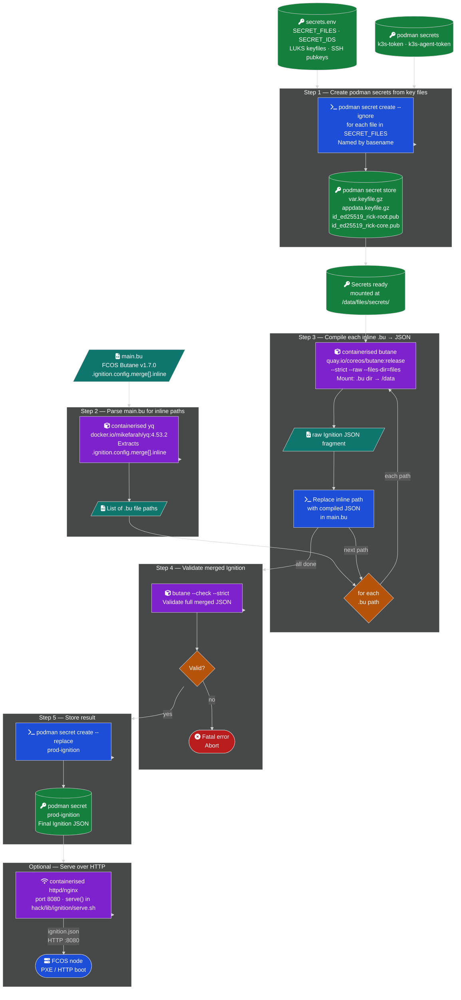
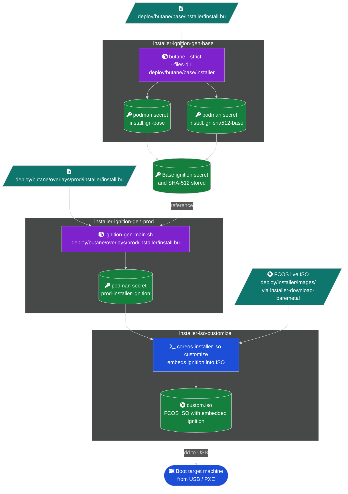

# Ignition Generation Pipeline

Fedora CoreOS nodes are configured entirely at first boot via [Ignition](https://coreos.github.io/ignition/). This repo uses [Butane](https://coreos.github.io/butane/) as a human-readable source format; the pipeline compiles Butane configs to Ignition JSON and stores the result as a podman secret ready to serve.

All tools (`butane`, `yq`) run containerised via podman — no host-side installation required.

---

## Pipeline Overview

**Diagram key**

| Symbol | Meaning |
|---|---|
| Rectangle | Script / process |
| Rounded rectangle | Config file / data |
| Cylinder | Persistent secret / storage |
| Diamond | Decision |
| Parallelogram | Input / output |
| Circle | Endpoint |
| 🔵 Blue | Script or process |
| 🟢 Green | Storage / secret |
| 🔴 Red | Error / abort |
| 🟡 Amber | Decision |
| 🟣 Purple | Container image / tool |
| 🩵 Teal | Config / data file |



---

## Entry Point

```
hack/bin/ignition-gen-main.sh <main.bu> [secrets.env]
```

Invoked by `make ignition-gen-<overlay>`. The prod overlay also passes `deploy/butane/overlays/prod/secrets.env`.

---

## Pipeline Steps

### Step 1 — Source secrets.env

If a `secrets.env` file is provided, it is sourced. It must define:

```bash
SECRET_FILES=(
    "$HOME/Documents/.luks_keys/var.keyfile.gz"
    "$HOME/Documents/.luks_keys/appdata.keyfile.gz"
    "$HOME/.ssh/id_ed25519_rick-root.pub"
    "$HOME/.ssh/id_ed25519_rick-core.pub"
)
SECRET_IDS=()   # optional: existing podman secret IDs to mount
```

See `deploy/butane/base/secrets-example.env` for a template and [docs/examples/secrets-env.md](examples/secrets-env.md) for a step-by-step guide.

### Step 2 — Create podman secrets from key files

Each path in `SECRET_FILES` becomes a podman secret named after its basename (e.g. `var.keyfile.gz`). The `--ignore` flag skips creation if the secret already exists, making the step idempotent.

### Step 3 — Parse main.bu and compile each inline

The pipeline uses containerised `yq` (`docker.io/mikefarah/yq:4.53.2`) to read every path under `.ignition.config.merge[].inline` in `main.bu`. For each path:

1. The directory containing the `.bu` file is mounted into the `butane` container as `/data`
2. All podman secrets are mounted at `/data/files/secrets/`
3. `butane --strict --raw --files-dir=files` compiles the `.bu` file to a raw Ignition JSON fragment
4. The path in `main.bu` is replaced with the compiled JSON

This is handled by `ignition_gen_config_merge_inlines` in `hack/lib/ignition/ignition.sh`.

The butane container image is `quay.io/coreos/butane:release`. The container working directory constant `__BUTANE_WORKDIR="/data"` is defined in `hack/lib/ignition/butane.sh`.

### Step 4 — Validate

The merged Ignition JSON is validated with `butane --check --strict` to catch any schema errors before storage.

### Step 5 — Store as podman secret

The final JSON is stored (with `--replace`) as a podman secret named `<overlay>-ignition`. The `make ignition-serve-httpd-<overlay>` and `make ignition-serve-nginx-<overlay>` targets read this secret and serve it via `serve()` in `hack/lib/ignition/serve.sh`.

---

## Butane Config Structure

```
deploy/butane/
├── base/                        # Shared config, merged into every overlay
│   ├── main.bu                  # Lists all base .bu files to merge
│   ├── btrfsmaintenance.bu
│   ├── etc-containers-systemd.bu
│   ├── etc-firewalld.bu
│   ├── etc-general.bu
│   ├── etc-security-limits.bu
│   ├── etc-sysctl.bu
│   ├── passwd.bu
│   ├── usr-local.bu
│   └── storage/
│       ├── disks.bu
│       └── filesystems.bu
└── overlays/
    ├── prod/                    # x86 bare-metal production node
    │   ├── main.bu              # Merges base + all prod-specific .bu files
    │   ├── secrets.env
    │   ├── etc-containers-secrets.bu
    │   ├── etc-containers-systemd.bu
    │   ├── etc-modprobe.bu
    │   ├── etc-sysconfig.bu
    │   ├── passwd.bu
    │   ├── usr-local.bu
    │   └── storage/
    │       ├── disks.bu         # Partition layout (50 GiB root + remaining var)
    │       ├── filesystems.bu   # btrfs volumes
    │       ├── luks.bu          # LUKS encryption config
    │       └── raid.bu          # mdadm RAID10 config
    ├── staging/                 # libvirt VM overlay
    └── rpi4-0/                  # Raspberry Pi 4 agent node
        ├── main.bu
        ├── storage.bu
        ├── system-config.bu
        └── usr.bu
```

Each `main.bu` is an FCOS Butane v1.7.0 file. The `inline` entries under `.ignition.config.merge` are file paths to other `.bu` files — the pipeline replaces each with its compiled Ignition JSON before producing the final merged config.

---

## Installer Ignition

The installer ignition is compiled separately for embedding into the FCOS ISO. Run from the `deploy/installer/` directory:

```bash
make -C deploy/installer installer-ignition-gen-base   # → install.ign podman secret + SHA-512
make -C deploy/installer installer-ignition-gen-prod   # compiles prod installer ignition
make -C deploy/installer installer-iso-customize        # embeds ignition into the downloaded ISO
```

The base ignition is stored as a podman secret along with its SHA-512 hash. The prod layer compiles `deploy/butane/overlays/prod/installer/install.bu` via the standard `ignition-gen-main.sh` pipeline.

**Diagram key** (same convention as the pipeline overview above)



---

## Key Library Files

| File | Purpose |
|------|---------|
| `hack/lib/ignition/ignition.sh` | Core pipeline logic (`ignition_gen_config_merge_inlines`) |
| `hack/lib/ignition/butane.sh` | Podman wrapper for containerized butane; defines `__BUTANE_WORKDIR="/data"` |
| `hack/lib/ignition/serve.sh` | HTTP serving via nginx / httpd containers |
| `hack/lib/podman/podman-secret.sh` | Secret create/inspect/mount helpers |
| `hack/lib/checksum/checksum.sh` | SHA-512 hash generation and verification |
| `hack/lib/logging.sh` | Logging stack (loads `hack/vendor/bash-utils/util/`) |
| `hack/lib/vendor-bash-utils-logging.sh` | Error message constants (`ERROR_ARG_REQUIRED`, etc.) |
