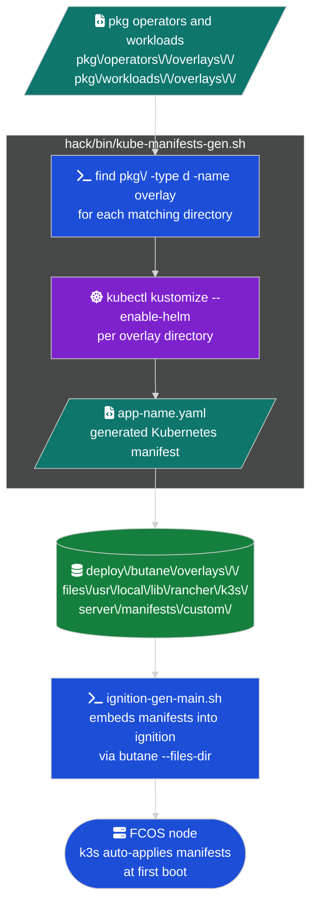

# Kubernetes — Operators & Workloads

The cluster runs [k3s](https://k3s.io/) on Fedora CoreOS nodes. All manifests are managed with [Kustomize](https://kustomize.io/) and generated via `kubectl kustomize --enable-helm` before being embedded into the ignition config for each node.

---

## Manifest Generation

```bash
make kube-manifests-gen-prod   # generates prod + rpi4 overlays
make kube-manifests-gen-all    # clean + regenerate all overlays
make clean                     # remove all generated YAML
```

`hack/bin/kube-manifests-gen.sh` finds all `overlays/<name>` directories under `pkg/`, runs `kubectl kustomize --enable-helm` on each, and writes the output to the target manifests path:

```
deploy/butane/overlays/<overlay>/files/usr/local/lib/rancher/k3s/server/manifests/custom/
```

These YAML files are embedded into the node's ignition config by butane and placed on disk at first boot so k3s picks them up automatically on startup. See [ignition-pipeline.md](ignition-pipeline.md) for how generated manifests become part of the ignition config.

**Diagram key**

| Symbol | Meaning |
|---|---|
| Rectangle | Script / process |
| Rounded rectangle | Config file / data |
| Cylinder | Persistent secret / storage |
| Parallelogram | Input / output |
| Circle | Endpoint |
| 🔵 Blue | Script or process |
| 🟢 Green | Storage / secret |
| 🟣 Purple | Container image / tool |
| 🩵 Teal | Config / data file |



### Disabled Apps

Some apps are excluded from manifest generation by the `apps_enabled` ERE regex in `hack/env/kube-manifests-gen.env`. To disable an app, add a `skip_<name>` variable and include it in `apps_enabled`.

Currently disabled (not generated):

| App | Variable |
|-----|----------|
| `pihole` | `skip_pihole` |
| `coredns-custom` | `skip_coredns_custom` |
| `cloudnative-pg` | `skip_cloudnative_pg` |
| `cloudnative-pg-cluster` | `skip_cloudnative_pg_cluster` |

All other apps in `pkg/` are generated when their overlay directory matches the target overlay name.

---

## Directory Structure

```
pkg/
├── operators/     # Cluster infrastructure operators
├── workloads/     # Application deployments
├── containers/    # Custom container image Containerfiles (with Makefile)
├── schemas/       # JSON value schemas for Helm chart validation
└── charts/        # Vendored Helm chart sources (downloaded by kustomize)
```

Each operator and workload follows the standard kustomize pattern:

```
<app>/
├── base/
│   ├── kustomization.yaml
│   └── ...
└── overlays/
    ├── prod/
    └── staging/
```

---

## Operators

| Operator | Purpose |
|----------|---------|
| `cert-manager` | TLS certificate management (Let's Encrypt + internal CA) |
| `coredns-custom` | Custom CoreDNS configuration for internal DNS resolution |
| `intel-device-plugins-operator` | Manages Intel hardware device plugin lifecycle |
| `intel-device-plugins-gpu` | Exposes Intel integrated GPU to pods |
| `kube-vip` | Load balancer / VIP for the k3s API and services |
| `local-path-provisioner` | Dynamic PVC provisioning from local node paths |
| `mariadb-operator` | Manages MariaDB cluster lifecycle |
| `mariadb-operator-crds` | CRD bundle for mariadb-operator |
| `node-feature-discovery` | Detects node hardware features and labels nodes |
| `traefik-custom` | Customised Traefik ingress controller configuration |

---

## Workloads

| Workload | Purpose |
|----------|---------|
| `jellyfin` | Self-hosted media server |
| `mariadb-cluster` | MariaDB database cluster for application data |
| `motion` | Motion detection system (camera surveillance) |
| `pihole` | Network-wide DNS ad-blocker |
| `v4l2rtspserver` | RTSP stream server for V4L2 camera devices |

---

## Custom Container Images

Several workloads depend on custom-built images maintained in `pkg/containers/`. Images are built via `pkg/containers/Makefile` (run as `make -C pkg/containers <target>`) and pushed to `docker.io/steve51516`. See [docs/examples/container-build-env.md](examples/container-build-env.md) for build env usage.

| Image | Architecture | Notes |
|-------|-------------|-------|
| `ffmpeg` | amd64 | Custom FFmpeg with hardware acceleration |
| `motion` | amd64 | Motion detection; depends on custom FFmpeg |
| `envsubst` | amd64 + arm64 | Multi-arch environment variable substitution utility |
| `btrfs-progs` | amd64 | btrfs tools for container use |
| `libcamera` | arm64 | Camera library for Raspberry Pi |
| `rpicam-apps` | arm64 | Raspberry Pi camera applications; depends on libcamera |
| `ffmpeg-rpi` | arm64 | FFmpeg for Raspberry Pi |

Multi-stage builds are used throughout: a builder stage compiles from source, a release stage copies only the runtime artefacts. Build arguments (version pins, compile flags) are defined in each image's `argfile.conf`.

---

## Networking

- **Ingress:** Traefik (customised via `pkg/operators/traefik-custom/`) — see [networking.md](networking.md) for the full ingress configuration
- **Load balancer:** kube-vip provides a stable VIP for the API server and `LoadBalancer` services
- **DNS:** CoreDNS with custom config for `expresso.lan` internal resolution; pihole handles upstream DNS filtering
- **TLS:** cert-manager issues certificates for ingress routes; Traefik is configured with a default TLS store

---

## Helm Chart Management

Helm charts are consumed inline via kustomize's `HelmChart` / `HelmRelease` resources with `--enable-helm`. Chart sources are vendored to `pkg/charts/` (gitignored, downloaded on demand). JSON value schemas in `pkg/schemas/` provide kustomize-level validation of Helm values files.
