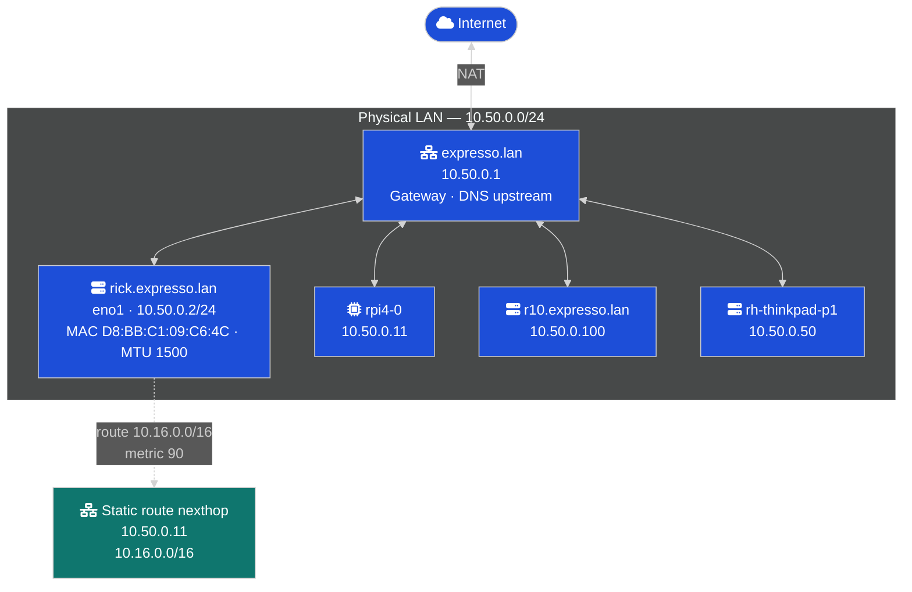
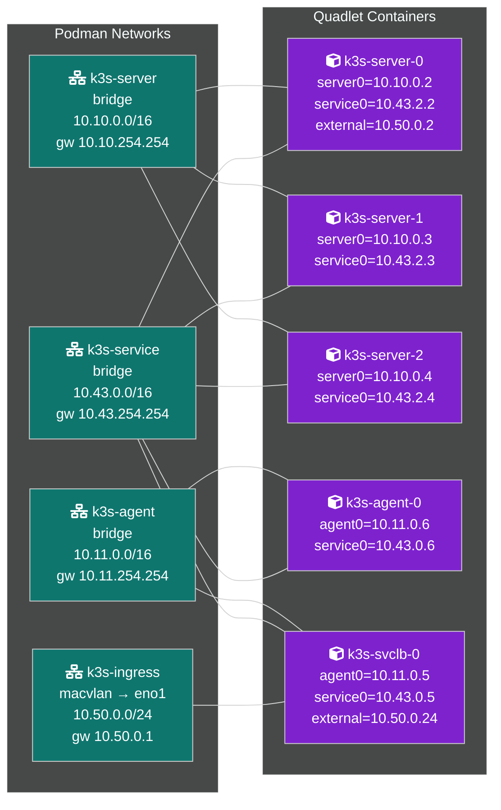
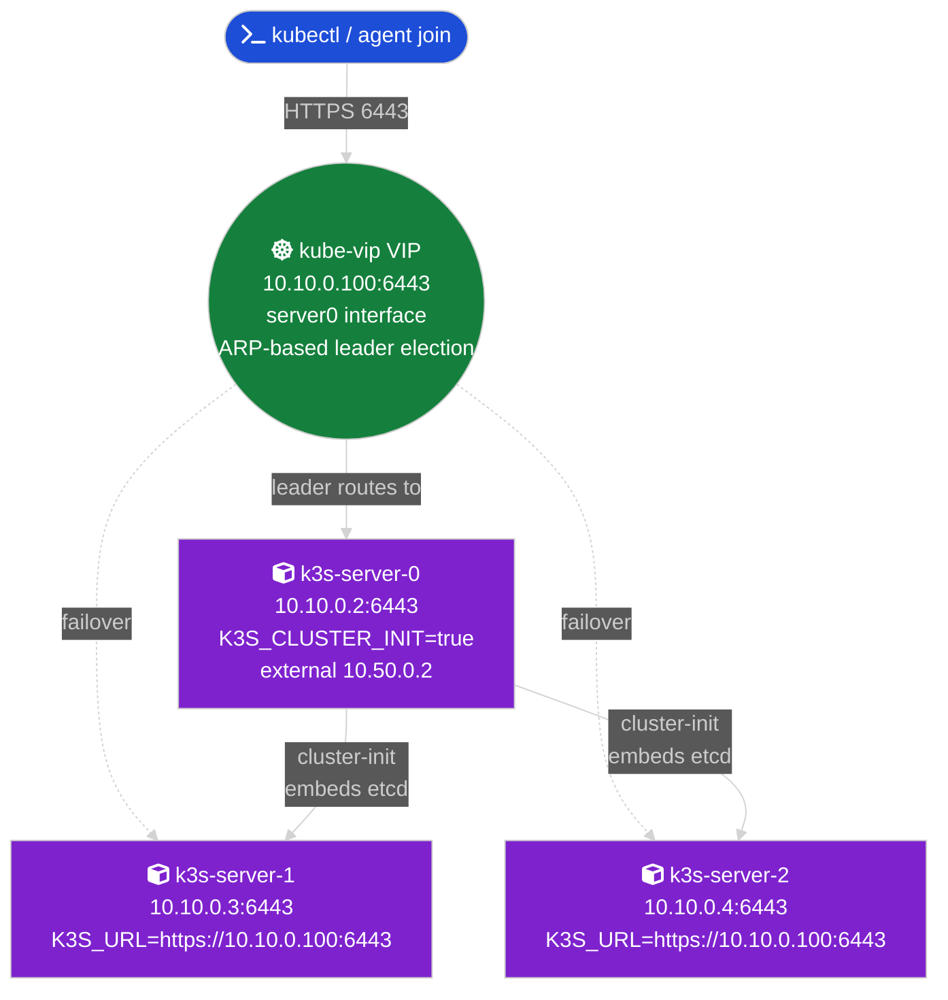
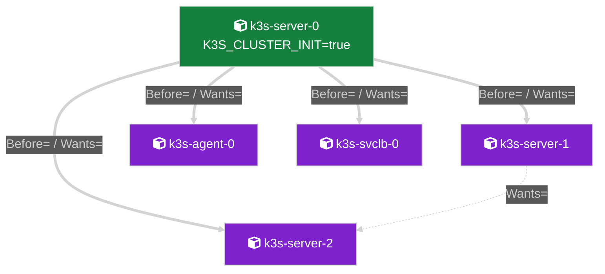
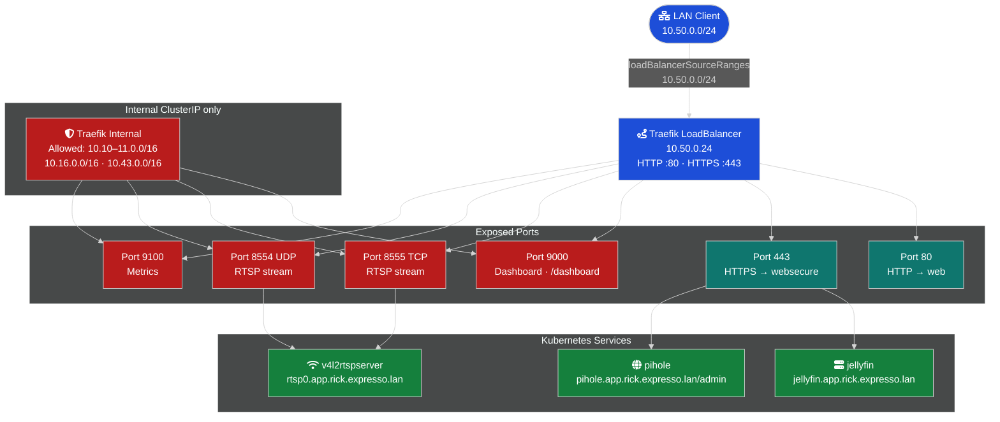
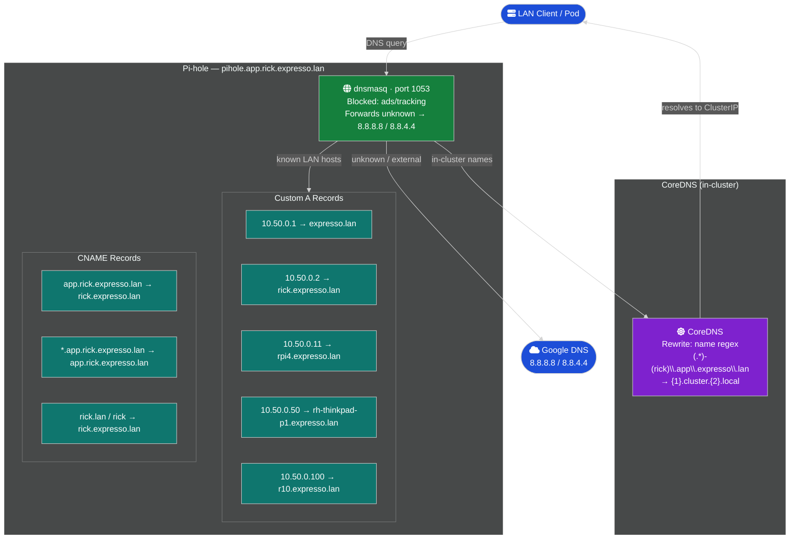
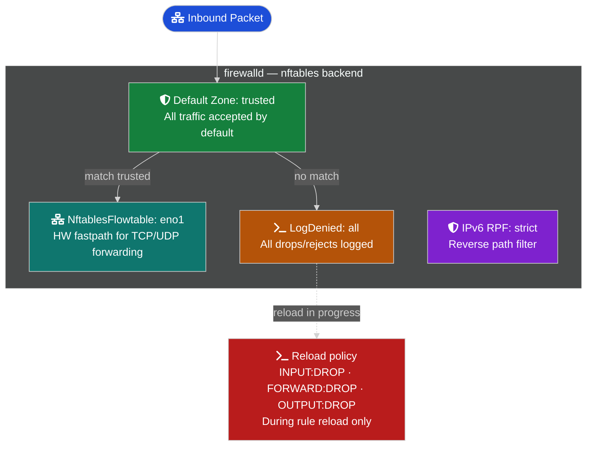

# Networking

This document covers all network layers in the cluster: the physical LAN, the podman container network fabric on the host, k3s cluster networking, ingress, DNS, and firewall configuration.

---

## Diagram Key

The following key applies to all diagrams in this document.

| Symbol | Meaning |
|---|---|
| Rectangle | Script / process / service |
| Rounded rectangle | Config data / address |
| Cylinder | Persistent storage / config |
| Diamond | Decision |
| Circle | Endpoint (client / external) |
| 🔵 Blue | Host, server, or active process |
| 🟢 Green | Storage, secret, or persistent service |
| 🟡 Amber | Decision or intermediate routing |
| 🟣 Purple | Container image / external tool |
| 🩵 Teal | Network / config data |
| 🔴 Red | Restricted or internal-only |

---

## Network Layers Overview

| Layer | Technology | Subnet / Range |
|-------|-----------|----------------|
| Physical LAN | NetworkManager · eno1 | 10.50.0.0/24 |
| Container — server plane | podman bridge `k3s-server` | 10.10.0.0/16 |
| Container — agent plane | podman bridge `k3s-agent` | 10.11.0.0/16 |
| Container — service plane | podman bridge `k3s-service` | 10.43.0.0/16 |
| Container — ingress plane | podman macvlan `k3s-ingress` | 10.50.0.0/24 (shared with LAN) |
| Kubernetes pod network | k3s (default CIDR) | 10.42.0.0/16 |
| Kubernetes service CIDR | k3s | 10.43.0.0/16 |
| Cluster/pod route | static via 10.50.0.11 | 10.16.0.0/16 |

---

## Physical Network

The production node `rick.expresso.lan` is the only node running k3s server containers. The RPi4 (`rpi4-0`) runs as an external k3s agent and must route back to the podman container networks on `rick` — the static route `10.16.0.0/16 via 10.50.0.11` facilitates this.

### Host interface — eno1

| Setting | Value |
|---------|-------|
| IP address | 10.50.0.2/24 |
| Gateway | 10.50.0.1 |
| DNS | 10.50.0.1, 8.8.8.8 |
| DNS search | expresso.lan |
| Static route | 10.16.0.0/16 via 10.50.0.11 (metric 90) |
| IPv6 | disabled |
| NftablesFlowtable | eno1 (hardware offload fastpath) |
| GRO / GSO / TSO | enabled |
| Ring buffers | 256 Rx / 256 Tx |

---

## Podman Container Network Fabric

All k3s processes run inside podman containers managed by systemd Quadlet units. Each container attaches to one or more named podman networks. The network backend is **netavark** with **nftables** as the firewall driver.

### Network definitions

| Podman network | Driver | Interface template | Subnet | Gateway |
|---------------|--------|--------------------|--------|---------|
| `k3s-server` | bridge | `server0` | 10.10.0.0/16 | 10.10.254.254 |
| `k3s-agent` | bridge | `agent0` | 10.11.0.0/16 | 10.11.254.254 |
| `k3s-service` | bridge | `service0` | 10.43.0.0/16 | 10.43.254.254 |
| `k3s-ingress` | macvlan | `eno1` | 10.50.0.0/24 | 10.50.0.1 |

The `k3s-ingress` network uses **macvlan** mode attached to `eno1`, giving the ingress container a distinct MAC and a routable IP on the physical LAN. This allows Traefik's LoadBalancer IP (10.50.0.24) to be directly reachable from the LAN without NAT.

### Container network attachments

| Container | server plane | agent plane | service plane | external IP |
|-----------|-------------|-------------|---------------|-------------|
| `k3s-server-0` | 10.10.0.2 | — | 10.43.2.2 | 10.50.0.2 |
| `k3s-server-1` | 10.10.0.3 | — | 10.43.2.3 | — |
| `k3s-server-2` | 10.10.0.4 | — | 10.43.2.4 | — |
| `k3s-agent-0` | — | 10.11.0.6 | 10.43.0.6 | — |
| `k3s-svclb-0` | — | 10.11.0.5 | 10.43.0.5 | 10.50.0.24 |

Container interface names are set explicitly via `interface_name=` in the Quadlet `Network=` directive (e.g. `kube-server.network:ip=10.10.0.2,interface_name=server0`).

---

## k3s Cluster Networking

### Control plane — kube-vip HA VIP

kube-vip runs as a DaemonSet and manages a virtual IP on the `server0` interface of control-plane nodes. Server-1 and server-2 both join the cluster via the VIP, not a specific node's IP.

**kube-vip configuration (prod):**

| Setting | Value |
|---------|-------|
| VIP address | 10.10.0.100 |
| VIP interface | `server0` (inside the container) |
| Mode | ARP leader election |
| LB port | 6443 |
| LB forward method | local |
| Service LB | disabled (`svc_enable: false`) |
| nftables egress | enabled |

**TLS SANs on k3s server (prod):**
- `10.10.0.1`, `10.10.0.100` (kube-vip VIP)
- `10.50.0.2` (host LAN IP)
- `rick.expresso.lan`, `api.rick.expresso.lan`

### Service startup order

---

## Ingress — Traefik

Traefik runs on the `k3s-svclb-0` node (the dedicated ingress / service LB node) and is exposed via a `LoadBalancer` service on the macvlan ingress network.

**Traefik values (prod):**

| Setting | Value |
|---------|-------|
| Image | `rancher/mirrored-library-traefik:3.6.9` |
| Service type | `LoadBalancer` (single, IPv4) |
| LB IP | 10.50.0.24 (macvlan ingress network) |
| LB source ranges | 10.50.0.0/24 |
| Internal ClusterIP source ranges | 10.10.0.0/16, 10.11.0.0/16, 10.16.0.0/16, 10.43.0.0/16 |
| Forwarded headers trusted IPs | 10.50.0.0/24, all internal subnets |
| Node selector | `svccontroller.k3s.cattle.io/enablelb=true` |
| TLS store | `default-certificate` (issued by `root-ca` ClusterIssuer) |
| Dashboard | `/dashboard`, `/api` on port 9000 (internal only) |
| RTSP TCP | 8555 (internal only) |
| RTSP UDP | 8554 (internal only) |
| Metrics | 9100 (internal only) |

---

## DNS

DNS resolution uses a two-tier approach: pihole handles LAN-level name resolution and upstream filtering; CoreDNS handles in-cluster name rewriting.

**DNS configuration summary:**

| Record type | Name | Value |
|-------------|------|-------|
| A | `expresso.lan` | 10.50.0.1 |
| A | `rick.expresso.lan` | 10.50.0.2 |
| A | `rpi4.expresso.lan` | 10.50.0.11 |
| A | `rh-thinkpad-p1.expresso.lan` | 10.50.0.50 |
| A | `r10.expresso.lan` | 10.50.0.100 |
| CNAME | `app.rick.expresso.lan` | `rick.expresso.lan` |
| CNAME | `*.app.rick.expresso.lan` | `app.rick.expresso.lan` |
| CNAME | `rick.lan`, `rick` | `rick.expresso.lan` |
| CNAME | `pihole.app.rick.expresso.lan` | `app.rick.expresso.lan` |
| CNAME | `jellyfin.app.rick.expresso.lan` | `app.rick.expresso.lan` |
| CNAME | `rtsp0.app.rick.expresso.lan` | `app.rick.expresso.lan` |

CoreDNS rewrite (`pkg/operators/coredns-custom/overlays/prod/`): any hostname matching `<svc>-<namespace>.app.expresso.lan` is internally resolved as `<svc>.cluster.<namespace>.local`.

Pi-hole runs on port **1053** inside its container (to avoid conflicts with systemd-resolved). The k3s service exposes it on ClusterIP port **1054**. DNS search domain on the host is `expresso.lan`, configured in the NetworkManager connection.

---

## Firewall

Firewall is managed by **firewalld** with an **nftables** backend.

| Setting | Value |
|---------|-------|
| Default zone | `trusted` |
| Backend | nftables |
| LogDenied | all |
| IPv6 RPFilter | strict |
| NftablesFlowtable | `eno1` (TCP/UDP fastpath) |
| Reload policy | `INPUT:DROP, FORWARD:DROP, OUTPUT:DROP` |
| FlushAllOnReload | yes |
| NftablesTableOwner | yes (exclusive ownership) |

> **Note:** Lockdown mode is configured but currently disabled in `firewalld.conf`. The default zone is `trusted`, meaning all traffic is accepted unless blocked by a specific rule.

---

## Kernel Networking (sysctl)

Applied via `deploy/butane/base/files/etc/sysctl.d/`:

| Parameter | Value | Purpose |
|-----------|-------|---------|
| `net.bridge.bridge-nf-call-iptables` | 1 | Required for k3s / container networking |
| `net.netfilter.nf_conntrack_tcp_timeout_close_wait` | 3600 | Extended TCP CLOSE_WAIT timeout |
| `net.netfilter.nf_conntrack_tcp_timeout_established` | 86400 | 24 h connection tracking for established flows |
| `net.netfilter.nf_conntrack_max` | 196608 | Increased conntrack table (container workloads) |
| `fs.inotify.max_user_watches` | 524288 | Required for large k3s manifest watches |
| `fs.inotify.max_user_instances` | 1024 | Required for controller managers |

---

## Quick Reference — IP Address Map

| Host / Service | IP | Role |
|---------------|-----|------|
| `expresso.lan` | 10.50.0.1 | LAN gateway, DNS upstream |
| `rick.expresso.lan` | 10.50.0.2 | Production host (eno1) |
| `rpi4-0` | 10.50.0.11 | k3s agent (Raspberry Pi 4) |
| `rh-thinkpad-p1.expresso.lan` | 10.50.0.50 | Workstation |
| `r10.expresso.lan` | 10.50.0.100 | Host |
| kube-vip VIP | 10.10.0.100 | Kubernetes API (HA, `server0` iface) |
| k3s-server-0 `server0` | 10.10.0.2 | Control plane node 0 |
| k3s-server-1 `server0` | 10.10.0.3 | Control plane node 1 |
| k3s-server-2 `server0` | 10.10.0.4 | Control plane node 2 |
| k3s-agent-0 `agent0` | 10.11.0.6 | Agent node (compute) |
| k3s-svclb-0 `agent0` | 10.11.0.5 | Service LB / ingress node |
| Traefik LoadBalancer | 10.50.0.24 | External ingress (macvlan) |
| k3s service CIDR | 10.43.0.0/16 | Kubernetes ClusterIP range |
| k3s pod CIDR | 10.42.0.0/16 | Default k3s pod network |
| Cluster/pod route | 10.16.0.0/16 | Routed via 10.50.0.11 (metric 90) |
