# Node Provisioning

End-to-end walkthrough for provisioning a new FCOS node from scratch.

---

## Provisioning Sequence

**Diagram key**

| Symbol | Meaning |
|---|---|
| Rectangle | Script / make target |
| Cylinder | Persistent secret / storage |
| Diamond | Decision / branch point |
| Circle | Endpoint (node / boot target) |
| 🔵 Blue | Script or process |
| 🟢 Green | Storage / secret |
| 🟡 Amber | Decision |
| 🟣 Purple | Container image / tool |
| 🩵 Teal | Config / data file |

```mermaid
%%{init: {'theme': 'dark'}}%%
flowchart TD
    PREREQS[/"fa:fa-file-code Prerequisites\nsecrets.env populated\nsubmodules initialised\nLUKS keyfiles and SSH pubkeys on host"/]

    subgraph TOKENS["Step 1 — Generate cluster tokens"]
        TOKEN_CMD["fa:fa-terminal make k3s-tokens-generate-prod"]
        K3S_SEC[("fa:fa-key podman secrets\nk3s-token\nk3s-agent-token\nprod-secretsdata.json")]
    end

    subgraph MANIFESTS["Step 2 — Generate Kubernetes manifests"]
        MANIFEST_CMD["fa:fa-terminal make kube-manifests-gen-prod\n(auto-dependency of ignition-gen-prod)"]
        YAML_FILES[("fa:fa-database deploy/butane/overlays/prod/\nfiles/.../manifests/custom/*.yaml")]
    end

    subgraph IGNITION["Step 3 — Generate ignition config"]
        IGN_CMD["fa:fa-terminal make ignition-gen-prod"]
        IGN_SEC[("fa:fa-key podman secret\nprod-ignition\nFinal merged Ignition JSON")]
    end

    DELIVERY{"Delivery\nmethod?"}

    subgraph HTTP_PATH["Network boot (HTTP)"]
        HTTPD_CMD["fa:fa-terminal make ignition-serve-httpd-prod"]
        HTTPD["fa:fa-wifi containerised httpd\nport 8080"]
    end

    subgraph ISO_PATH["Offline / airgap (ISO)"]
        ISO_DL["fa:fa-compact-disc make -C deploy/installer\ninstaller-download-baremetal"]
        ISO_IGN["fa:fa-terminal make -C deploy/installer\ninstaller-ignition-gen-prod"]
        ISO_CUST["fa:fa-terminal make -C deploy/installer\ninstaller-iso-customize"]
        ISO_OUT[("fa:fa-compact-disc custom.iso\nFCOS ISO with embedded ignition")]
    end

    NODE_BOOT(["fa:fa-server FCOS node boots\nIgnition applies config"])

    subgraph FIRSTBOOT["First boot — automatic"]
        K3S_START["fa:fa-dharmachakra k3s server/agent starts\nvia systemd Quadlet units"]
        MANIFESTS_APPLY["fa:fa-dharmachakra k3s applies manifests\nfrom /usr/local/lib/rancher/k3s/\nserver/manifests/custom/"]
    end

    PREREQS --> TOKENS
    TOKENS --> TOKEN_CMD
    TOKEN_CMD --> K3S_SEC
    K3S_SEC --> MANIFESTS

    MANIFESTS --> MANIFEST_CMD
    MANIFEST_CMD --> YAML_FILES
    YAML_FILES --> IGNITION

    IGNITION --> IGN_CMD
    IGN_CMD --> IGN_SEC
    IGN_SEC --> DELIVERY

    DELIVERY -->|"network"| HTTP_PATH
    DELIVERY -->|"offline"| ISO_PATH

    HTTP_PATH --> HTTPD_CMD
    HTTPD_CMD --> HTTPD
    HTTPD -->|"ignition.json\nHTTP :8080"| NODE_BOOT

    ISO_PATH --> ISO_DL
    ISO_DL --> ISO_IGN
    ISO_IGN --> ISO_CUST
    ISO_CUST --> ISO_OUT
    ISO_OUT -->|"dd to USB"| NODE_BOOT

    NODE_BOOT --> FIRSTBOOT
    FIRSTBOOT --> K3S_START
    K3S_START --> MANIFESTS_APPLY

    style PREREQS fill:#0f766e,stroke:#ccc,color:#fff
    style TOKEN_CMD fill:#1d4ed8,stroke:#ccc,color:#fff
    style K3S_SEC fill:#15803d,stroke:#ccc,color:#fff
    style MANIFEST_CMD fill:#1d4ed8,stroke:#ccc,color:#fff
    style YAML_FILES fill:#15803d,stroke:#ccc,color:#fff
    style IGN_CMD fill:#1d4ed8,stroke:#ccc,color:#fff
    style IGN_SEC fill:#15803d,stroke:#ccc,color:#fff
    style DELIVERY fill:#b45309,stroke:#ccc,color:#fff
    style HTTPD_CMD fill:#1d4ed8,stroke:#ccc,color:#fff
    style HTTPD fill:#7e22ce,stroke:#ccc,color:#fff
    style ISO_DL fill:#1d4ed8,stroke:#ccc,color:#fff
    style ISO_IGN fill:#1d4ed8,stroke:#ccc,color:#fff
    style ISO_CUST fill:#1d4ed8,stroke:#ccc,color:#fff
    style ISO_OUT fill:#15803d,stroke:#ccc,color:#fff
    style NODE_BOOT fill:#1d4ed8,stroke:#ccc,color:#fff
    style K3S_START fill:#7e22ce,stroke:#ccc,color:#fff
    style MANIFESTS_APPLY fill:#7e22ce,stroke:#ccc,color:#fff
```



---

## Why Tokens Are Pre-Generated

k3s server nodes must all share the same `K3S_TOKEN` to form a cluster. Agents need the same `K3S_AGENT_TOKEN` that the server was started with. Both values must be known _before_ any node boots so they can be embedded into the ignition configs of every node in one build step.

Generating tokens on first boot would require an out-of-band coordination mechanism to distribute them — defeating the goal of fully declarative, self-contained ignition files.

See also: [k3s token documentation](https://docs.k3s.io/cli/token#short), [k3sup HA setup](https://github.com/alexellis/k3sup#create-a-multi-master-ha-setup-with-external-sql).

---

## Prerequisites

1. **Secrets outside the repo** — LUKS keyfiles and SSH public keys must exist at the paths declared in `secrets.env`. Copy and populate `deploy/butane/base/secrets-example.env` as `deploy/butane/overlays/prod/secrets.env`. See [docs/examples/secrets-env.md](examples/secrets-env.md) for a step-by-step guide.

2. **Podman** running as the user who will run `make`.

3. **Submodules initialised:**
   ```bash
   git submodule update --init --recursive
   ```

---

## Production Node (rick.expresso.lan)

### Step 1 — Generate cluster tokens

```bash
make k3s-tokens-generate-prod
```

Creates podman secrets `k3s-token` and `k3s-agent-token`. Run once; skip if secrets already exist (script will warn).

### Step 2 — Generate ignition

```bash
make ignition-gen-prod
```

Reads `secrets.env`, compiles all Butane configs, embeds Kubernetes manifests, and stores the result as the `prod-ignition` podman secret.

Full pipeline details: [docs/ignition-pipeline.md](ignition-pipeline.md).
Storage configuration details: [docs/storage-layout.md](storage-layout.md).

### Step 3a — Serve over HTTP (network boot)

```bash
make ignition-serve-httpd-prod
```

Serves the ignition config on port 8080. Boot the target machine and point the FCOS live environment at:

```
http://<build-host-ip>:8080/ignition.json
```

> **Security note:** Ignition is served over plain HTTP. The ignition file contains pre-shared cluster tokens. Use a trusted private network or VLAN during provisioning, or generate HTTPS certificates via `hack/bin/ignition-gen-serving-certs.sh`.

### Step 3b — Embed in ISO (offline / airgap)

See the [Installer ISO Path](#installer-iso-path) section below.

---

## Raspberry Pi 4 Agent Node (rpi4-0)

The RPi4 requires UEFI firmware before FCOS can boot from NVMe.

### Step 1 — Set up UEFI firmware

```bash
hack/bin/rpi4-edk2-setup.sh
```

Downloads and writes the [pftf/RPi4](https://github.com/pftf/RPi4) EDK2 UEFI firmware to the UEFI SD card or USB drive.

### Step 2 — Generate ignition

```bash
make ignition-gen-rpi4-0
```

### Step 3 — Install to disk

```bash
hack/bin/rpi4_disk_install.sh
```

Writes FCOS to the NVMe drive with the generated ignition config. See [Fedora CoreOS RPi4 documentation](https://docs.fedoraproject.org/en-US/fedora-coreos/provisioning-raspberry-pi4/) for full hardware setup.

---

## Installer ISO Path

For offline or airgap provisioning, a customised FCOS ISO with embedded ignition can be built using `deploy/installer/Makefile`. All targets in this section are run as `make -C deploy/installer <target>`.

### Step 1 — Download the FCOS ISO

```bash
make -C deploy/installer installer-download-baremetal
```

Downloads the latest stable FCOS live ISO to `deploy/installer/images/`.

### Step 2 — Validate butane configs (optional)

```bash
make -C deploy/installer installer-butane-check-prod
```

Runs `butane --check --strict` on the installer butane configs before compilation.

### Step 3 — Compile installer ignition

```bash
make -C deploy/installer installer-ignition-gen-prod
```

Compiles `deploy/butane/overlays/prod/installer/install.bu` through the standard `ignition-gen-main.sh` pipeline and stores the result as a podman secret.

### Step 4 — Customize the ISO

```bash
make -C deploy/installer installer-iso-customize
```

Embeds the ignition config into the downloaded ISO via `coreos-installer iso customize`, producing `*_custom.iso`.

### Step 5 — Flash to USB

```bash
# Replace /dev/sdX with the correct device
sudo dd if=deploy/installer/images/*_custom.iso of=/dev/sdX status=progress && sudo sync
```

Boot the target machine from the USB drive. Installation runs unattended.

---

## Rotating Secrets

### Rotate cluster tokens

```bash
podman secret rm k3s-token k3s-agent-token
make k3s-tokens-generate-prod
make ignition-gen-prod
```

Then re-provision affected nodes — token changes require a full re-provision since they are baked into the ignition config.

### Rotate LUKS keyfiles

1. Update the keyfile at the path declared in `secrets.env`
2. Remove the corresponding podman secret: `podman secret rm <keyfile-basename>`
3. Re-run `make ignition-gen-prod` — the pipeline recreates the secret from the updated file

---

## Troubleshooting

**Ignition generation fails with "file not found"**
Ensure all paths in `SECRET_FILES` within `secrets.env` exist on the build host.

**butane reports validation errors**
Run with `XTRACE=1 make ignition-gen-prod` to see the full containerised butane invocation. Check which `.bu` file is failing — the error will include the inline path.

**k3s nodes cannot join the cluster**
Verify that the same `k3s-token` podman secret was used when generating ignition for both the server and agent nodes. If tokens were rotated between builds, all nodes must be re-provisioned together.
