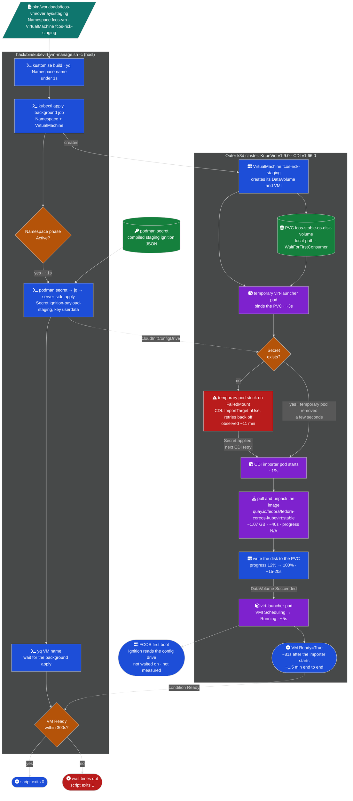

# Staging VM — KubeVirt on k3d

The `staging` overlay runs as a KubeVirt `VirtualMachine` on a local [k3d](https://k3d.io) cluster instead of on hardware. FCOS receives its ignition config through a `cloudInitConfigDrive` volume backed by a Kubernetes Secret, which `hack/bin/kubevirt-vm-manage.sh` fills from the podman secret holding the compiled ignition JSON.

Two clusters are involved. The **outer** k3d cluster runs [KubeVirt](https://kubevirt.io) and CDI (Containerized Data Importer) and hosts the VM. The **inner** k3s cluster boots inside the FCOS guest from its ignition config. This page covers the outer cluster and the VM's provisioning.

---

## Bringing the VM Up

```bash
make k3d-cluster-create-staging   # outer k3d cluster, KubeVirt and CDI
make generate-ignition-staging    # compile the staging ignition into a podman secret

hack/bin/kubevirt-vm-manage.sh -c \
  -k pkg/workloads/fcos-vm/overlays/staging \
  -i <podman_ignition_secret>
```

`make staging-vm-up` wraps these steps. `hack/bin/kubevirt-vm-manage.sh -h` lists the options; `-d` (delete the VM) is not implemented yet.

With `-c`, the script:

1. Builds the kustomize directory and reads the Namespace name (`fcos-vm`) from the manifests.
2. Applies the manifests (the Namespace and the `VirtualMachine`) in a background job.
3. Waits for the Namespace's phase to be `Active`.
4. Reads the Secret name from the VM's `cloudInitConfigDrive` volume (`ignition-payload-staging`) and server-side applies the Secret, with the ignition JSON base64-encoded under the key `userdata`.
5. Reads the VM's name (`fcos-rick-staging`), waits for the background apply to finish, then waits for the VM's `Ready` condition.

Both waits use `kube::kubectl_wait`'s default timeout of 300s.

---

## Provisioning Flow and Timings

The VM's OS disk is a CDI `DataVolume` that imports `quay.io/fedora/fedora-coreos-kubevirt:stable` from the registry the first time the VM is created, so most of the time to `Ready` is the image download.

**Diagram key**

| Symbol | Meaning |
|---|---|
| Rectangle | Script / process |
| Cylinder | Persistent secret / storage |
| Diamond | Decision / wait |
| Parallelogram | Input / output |
| Rounded | Endpoint |
| Dotted arrow | Observed or consumed by, not a step |
| 🔵 Blue | Script or process |
| 🟢 Green | Storage / secret |
| 🔴 Red | Error / stall |
| 🟡 Amber | Decision / wait |
| 🟣 Purple | Pod / container image |
| 🩵 Teal | Config / data file |

Times are from one measured run (see [Measured timeline](#measured-timeline)); "a few seconds" marks the one phase that wasn't measured cleanly.



### Measured Timeline

One run on 2026-10-22, polled every 5s, so each time is accurate to about ±5s. The clock starts when CDI created the importer pod:

| Time (UTC) | Event | Elapsed |
|---|---|---|
| 05:08:34 | CDI creates the import pod | 0s |
| 05:08:53 | `ImportInProgress`, downloading (no percentage reported) | ~19s |
| 05:09:34 → 05:09:44 | Writing the disk, 12% → 91% | ~60–70s |
| 05:09:50 | DataVolume `Succeeded` | ~76s |
| 05:09:55 | VM `Running`, `ready=true` | **~81s** |

Environment: k3d with k3s v1.35.5, KubeVirt v1.9.0, CDI v1.66.0, `local-path` storage, a 20Gi DataVolume, and FCOS 44.20260928.3.1 (`fedora-coreos-kubevirt:stable`, about 1.07 GB compressed).

### Estimated End-to-End Time

For a clean run, where the Secret exists before the VM's pod needs it:

| Phase | Time | Source |
|---|---|---|
| Script: kustomize build, yq lookups, start the apply | under 1s | measured (script log) |
| VM creates its DataVolume; the PVC binds via a temporary virt-launcher pod | ~3s | measured (events) |
| Temporary pod removed; CDI creates the importer | a few seconds | estimated |
| Importer pod starts | ~19s | measured |
| Image pulled and unpacked (progress `N/A`) | ~40s | measured |
| Disk written (progress 12% → 100%) | ~15–20s | measured |
| VM starts (VMI `Scheduling` → `Running`) | ~5s | measured |
| **Total** | **~1.5 min** | |

The pull varies most: about 1.07 GB at whatever bandwidth the cluster has to quay.io. On a fresh cluster the importer pod may also take longer to start while its node pulls CDI's importer image.

### Timeouts

The 300s default leaves about 3.5× headroom over the measured ~81s; the download would have to run about six times slower to use it up. Passing `-t 600s` to the VM wait is a cheap margin for slow networks and fresh clusters, since a longer timeout only costs time when something is already broken.

### What `Ready` Means

`Ready=True` means the VM's instance is running: the virt-launcher pod is up and the domain has started. It does not wait for FCOS to finish booting, for Ignition to apply the config, or for k3s to start inside the guest, and none of those were measured. Checking guest readiness needs something separate, such as a readiness probe on the VM.

---

## Re-runs and Re-imports

- Re-running `-c` against an existing VM is quick: both applies are idempotent, and the DataVolume has already `Succeeded`, so the image isn't downloaded again.
- Ignition runs only on an FCOS machine's first boot. Updating the Secret doesn't reconfigure a VM that has already booted; delete and recreate the VM for that.
- Deleting the VM also deletes its DataVolume, which comes from the VM's `dataVolumeTemplates`, so recreating the VM downloads and imports the image again (about 1.5 minutes).

---

## Troubleshooting

### VM Stuck in `Provisioning`

If the Secret doesn't exist when the VM is created, the import can't start and the VM stays at `Provisioning`, `READY False`:

1. The temporary virt-launcher pod can't mount the Secret (`FailedMount … secret "ignition-payload-staging" not found`) and stays at `Init:0/1`. KubeVirt deletes it once the PVC binds, but it doesn't go away until the Secret can be mounted.
2. That pod holds the PVC, so CDI refuses to start the importer: `ImportTargetInUse` in the events, and `can't create import pod, pvc in use by other pod` in CDI's log.
3. CDI retries with a doubling interval: observed 2s, 5s, 11s, 20s, 41s, 82s, 164s, 327s. That matches controller-runtime's default backoff, which keeps doubling up to a 1000s cap.

Once the Secret exists, the kubelet retries the mount on its own backoff, the temporary pod goes away, and the import starts at CDI's next retry. This happens when the script fails after it starts the background apply, for example at the Namespace wait: the apply still creates the VM, but the Secret step never runs.

Observed timeline of one such run:

| Time (UTC) | Event |
|---|---|
| 04:57:36 | VM, DataVolume, VMI and temporary launcher pod created; the script failed at the Namespace wait |
| 04:57:39 | PVC bound; KubeVirt deletes the temporary pod |
| 04:57:40 | `FailedMount`: Secret not found |
| 04:57:42 – 05:03:07 | CDI: `can't create import pod, pvc in use by other pod`, retrying at growing intervals |
| ~05:04:02 | Secret applied by re-running the script |
| 05:05:55 | Kubelet mounts the Secret; the temporary pod is removed at 05:05:56 |
| 05:08:34 | CDI's next retry creates the importer |
| 05:09:55 | VM `Ready`, about 13 minutes after creation instead of about 1.5 |

Diagnose:

```bash
kubectl -n fcos-vm get vm,vmi,dv,pods
kubectl -n fcos-vm get events --sort-by=.lastTimestamp
kubectl -n cdi logs deploy/cdi-deployment | grep fcos-stable-os-disk-volume
```

Fix: run `kubevirt-vm-manage.sh -c` again to create the Secret, then wait for CDI's next retry. If its interval has already grown long, deleting the VM and running `-c` again is quicker, about 1.5 minutes:

```bash
kubectl -n fcos-vm delete vm fcos-rick-staging
hack/bin/kubevirt-vm-manage.sh -c \
  -k pkg/workloads/fcos-vm/overlays/staging \
  -i <podman_ignition_secret>
```
