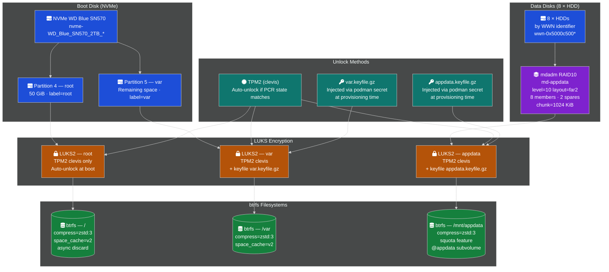

# Storage Layout — Production Node

The production node (`rick.expresso.lan`) uses a layered storage architecture: mdadm RAID10 for bulk storage, LUKS encryption on every volume, and btrfs on top.

All storage configuration lives under `deploy/butane/overlays/prod/storage/`. LUKS keyfiles reach the node via podman secrets during ignition generation — see [docs/ignition-pipeline.md](ignition-pipeline.md) for details.

---

## Disk Overview

| Volume | Source | Mount | Filesystem | Encryption |
|--------|--------|-------|------------|------------|
| `root` | Boot disk partition 4 (50 GiB) | `/` | btrfs | LUKS via TPM2 (clevis) |
| `var` | Boot disk partition 5 (remaining) | `/var` | btrfs | LUKS via TPM2 + keyfile  `secrets/var.keyfile.gz` |
| `appdata` | 8 × HDD in mdadm RAID10 (`md-appdata`) | `/mnt/appdata` | btrfs | LUKS via TPM2 + keyfile `secrets/appdata.keyfile.gz` |

---

## Storage Stack

**Diagram key**

| Symbol | Meaning |
|---|---|
| Rectangle | Process / layer |
| Cylinder | Persistent storage / mount |
| Diamond | Decision |
| 🔵 Blue | Physical disk |
| 🟡 Amber | LUKS encryption layer |
| 🟣 Purple | RAID / assembly layer |
| 🟢 Green | Mounted filesystem (btrfs) |
| 🩵 Teal | Unlock method |

---

## Boot Disk Partitioning (`storage/disks.bu`)

The boot disk uses the standard FCOS partition scheme with two additional partitions carved out after the reserved space:

| Partition | Label | Size | Use |
|-----------|-------|------|-----|
| 1–3 | (FCOS reserved) | — | EFI, BIOS boot, boot |
| 4 | `root` | 50 GiB | LUKS → btrfs `/` |
| 5 | `var` | Remaining | LUKS → btrfs `/var` |

---

## LUKS Encryption (`storage/luks.bu`)

### root

- **Method:** TPM2 via [clevis](https://github.com/latchset/clevis)
- **Unlock:** Automatic at boot if TPM2 PCR state matches; no passphrase required
- **Fallback:** Manual passphrase if TPM2 binding fails

### var

- **Method:** TPM2 (clevis) **and** keyfile (`secrets/var.keyfile.gz`) injected at provisioning time via podman secrets
- The keyfile is gzip-compressed and stored outside the repo at a path declared in `secrets.env`

### appdata

- **Method:** TPM2 (clevis) **and** keyfile (`secrets/appdata.keyfile.gz`)
- Dual-binding allows either TPM2 automatic unlock or manual keyfile unlock
- Provides recovery path if TPM2 state changes (e.g. firmware update)
- The keyfile is gzip-compressed and stored outside the repo at a path declared in `secrets.env`

| Volume | Unlock method | Strategy |
|--------|--------------|----------|
| `root` | TPM2 only | Auto-unlock; no keyfile recovery |
| `var` | TPM2 + keyfile | Dual binding; keyfile provides recovery |
| `appdata` | TPM2 + keyfile | Dual binding; keyfile provides recovery |

---

## RAID10 — appdata (`storage/raid.bu`)

Eight HDDs assembled as a single mdadm array:

| Parameter | Value |
|-----------|-------|
| Array name | `md-appdata` |
| Level | RAID10 |
| Layout | `far2` |
| Spares | 2 |
| Chunk size | 1024 KiB |
| Member count | 8 |

`far2` layout distributes copies across non-adjacent drives, improving sequential read performance compared to `near` layout while retaining the same fault tolerance (survives any single drive failure, often multiple).

---

## btrfs (`storage/filesystems.bu`)

All volumes use btrfs with `compress=zstd:3` and `space_cache=v2`. The NVMe local-path volume additionally sets `x-systemd.device-timeout=0` to avoid mount timeouts during storage discovery.

btrfs maintenance (balance, scrub, defrag, trim) is handled by the systemd timer units from the [btrfsmaintenance](https://github.com/kdave/btrfsmaintenance) project, embedded as a git submodule at `deploy/butane/base/files/usr/local/src/btrfsmaintenance/`.

---

## local-path Provisioner Volumes

The k3s [local-path-provisioner](https://github.com/rancher/local-path-provisioner) exposes storage to workloads via named Quadlet volumes:

| Volume | Mount in container | Backing storage |
|--------|-------------------|-----------------|
| `local-path@default` | `/mnt/local-path/default` | Boot disk `/var` |
| `local-path@appdata` | `/mnt/local-path/appdata` | `/mnt/appdata` (RAID10) |
| `local-path@nvme` | `/mnt/local-path/nvme` | NVMe device |

The `local-path@nvme` volume uses a drop-in override (`local-path@nvme.volume.d/override.conf`) to set btrfs-specific mount options (`compress=zstd:3`, `space_cache=v2`).
